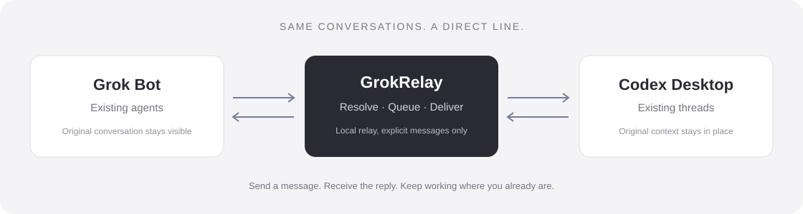

# GrokRelay

**Connect Grok Bot to your existing tools. Starting with Codex Desktop.**

[](https://github.com/w-yyh/grok-relay/actions/workflows/ci.yml)
[](LICENSE)
[](docs/COMPATIBILITY.md)

[Agent guide](docs/AGENT_GUIDE.md) · [Setup](docs/SETUP.md) · [Compatibility](docs/COMPATIBILITY.md) · [中文](docs/README.zh-CN.md)

GrokRelay lets **Grok Bot agents and existing Codex Desktop threads** find each other, exchange explicit messages, and receive replies in their original conversations. Your agents keep their context; you can follow the exchange in both apps.



> **Public alpha — Windows only.** The desktop adapters use internal or non-officially-stable interfaces. The relay has been exercised in real desktop conversations; the optional native tray host is a preview with interaction and memory acceptance still pending. This is an independent project, not an official OpenAI or Grok Bot integration. [What is verified →](docs/COMPATIBILITY.md)

## When to use it

| Scenario                       | Example                                                                                                                |
| ------------------------------ | ---------------------------------------------------------------------------------------------------------------------- |
| Specialist → developer         | A content agent asks an existing website development thread to review a copy change.                                   |
| Developer → specialist         | A coding agent asks a research agent for a source or product detail, then receives the response in its working thread. |
| Operator-visible collaboration | You want cross-agent exchanges to remain visible in the desktop conversations you already monitor.                     |

GrokRelay is a communications layer. It does not replace your agents, create new Codex CLI model sessions, decide business approvals, or automatically forward every chat message. It is not a cloud agent orchestration service.

## What it does

- **Find the right contact.** Stable local addresses and unique aliases map to existing bots and threads.
- **Send explicit messages.** Use the JSON CLI or a standalone envelope in the original conversation.
- **Return replies.** Replies are correlated with the destination turn/request, without endless acknowledgment loops.
- **Stay readable.** A short sender/type header and the message body; queue metadata stays local.
- **Wait for busy threads.** Persist queued work, reconnect, and avoid blindly retrying uncertain submissions.
- **Use an optional small interface.** A Wails tray panel, a separate editing window, and on-demand WebViews. No bundled browser or frontend framework.

## Quick start

You need Windows, Node.js **22.19+**, PowerShell **7**, and signed-in Codex Desktop and Grok Bot apps under the same Windows user. No separate model API key is required by GrokRelay.

```powershell
git clone https://github.com/w-yyh/grok-relay.git
cd grok-relay
npm ci --ignore-scripts
```

Create your contact configuration **outside the repository**, using [the setup example](docs/SETUP.md#register-contacts). It requires real bot IDs, an existing Codex thread ID and that thread's workspace. The shipped `contacts.example.json` is deliberately empty.

```powershell
node bridge.cjs init --file C:\path\to\contacts.json
node bridge.cjs doctor --json
node bridge.cjs start
node bridge.cjs contacts --json
```

Open the registered Codex thread in the desktop app. Introduce the addresses and message format to both agents, or install the included [agent skill](skills/grok-relay/SKILL.md) using your agent host's normal mechanism.

### For agents with shell access

Use addresses returned by `contacts`. These examples are fictional:

```powershell
node bridge.cjs contacts --query developer --json
node bridge.cjs send --from grok:writer --to codex:website --file C:\path\to\request.txt
node bridge.cjs message --id <returned-message-id> --include-text
```

The send command returns a JSON receipt. **`queued` is not `delivered`, and a reply is not proof of task completion.** Preserve the returned ID and inspect the reply content. See [the agent guide](docs/AGENT_GUIDE.md) for exact states, error handling and polling guidance.

### For agents without shell access

Emit a standalone message, with no code fences or surrounding prose:

```text
[[bridge:send codex:website]]
Please review the proposed homepage copy and reply with your recommendation.
[[/bridge]]
```

Reply normally to an incoming **Message**. To continue after a **Reply**, send another explicit envelope. Ordinary chat and quoted examples are not forwarded.

## Optional native interface

The relay works without the GUI. To build the native tray host, also install Go **1.25+** and the system WebView2 Runtime:

```powershell
npm run build:desktop
npm start
# Only a tray icon at startup:
node launch.cjs --tray
```

The host follows magpie's tray-panel/main-window structure: windows are created on demand, a hidden popup is released after eight seconds, and hidden interfaces stop refreshing. **No fixed memory budget is claimed yet.** Actual usage includes the native host, WebView processes, Node service and worker.

## Privacy

Configuration and message state default to `%LOCALAPPDATA%\GrokRelay`, outside the source tree. There is no GrokRelay cloud relay or telemetry. Messages still travel through the connected desktop products and their services.

The Grok adapter uses the active desktop login under the current Windows user; it decrypts the access token in memory and does not persist it in plaintext. Contact IDs, queue bodies, logs and local drafts remain private runtime data. Do not share them in issues or screenshots. [Data flow and exclusions →](docs/PRIVACY.md)

## Current limits

- Internal desktop interfaces can break after app updates; see the observed [compatibility matrix](docs/COMPATIBILITY.md).
- Text and links only. No attachment transfer, remote machines or macOS/Linux support.
- Grok polling is normally about 30 seconds and reads a recent 80-entry window. Long-offline backfill is not guaranteed.
- Uncertain sends require inspection before retrying. No automatic retention policy, signed installer, startup registration or updater yet.
- Native tray interaction, DPI and full process-tree memory acceptance remain pending. The web interface and relay have separate verification records.

## Development

```powershell
npm test
npm run format:check
npm run check:release
```

Use disposable `BRIDGE_DATA_DIR` data for development. CI runs offline tests and builds the Windows host without desktop accounts or credentials. See [architecture](docs/ARCHITECTURE.md), [contributing](CONTRIBUTING.md) and [changelog](CHANGELOG.md).

## License and acknowledgments

[MIT](LICENSE). Thanks to [Wails](https://github.com/wailsapp/wails), [grok-bot-cli](https://github.com/ScriptedAlchemy/grok-bot-cli), and [magpie](https://github.com/yetone/magpie) for its desktop design reference. Third-party notices are in [THIRD_PARTY_NOTICES.md](THIRD_PARTY_NOTICES.md). Product names identify compatibility; they do not imply endorsement.
